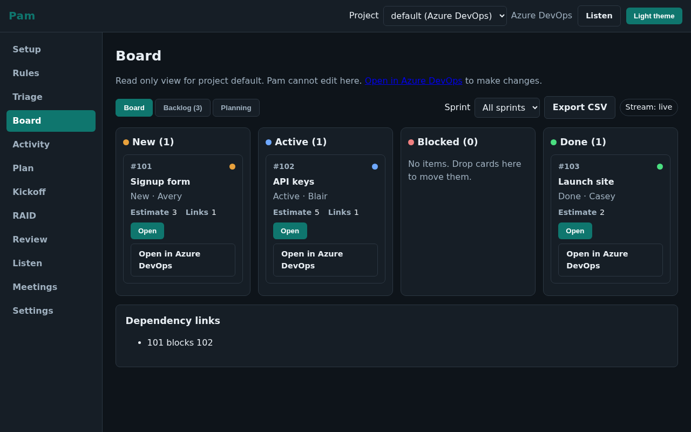

# Pam: Projects Autonomously Managed

Pam is an async project manager that replaces status meetings. It checks in with each teammate in Slack, challenges vague answers, keeps the board accurate, and chases blockers until they clear.

## Video

Watch the live run (2:30, recorded on real Slack, real Azure DevOps, and the real console): YouTube link will be posted here.



Screenshots for each console screen live in `docs/images/`.

## Quickstart

You need nothing installed: no Python, no git, no admin rights. You will need a Meta Model API key, a Slack workspace where you can create an app, and a board backend for the wizard steps (built-in Pam board with no account needed, or Azure DevOps, Jira, Linear, Trello, ClickUp, Asana, or Monday).

Windows (PowerShell):

```powershell
powershell -ExecutionPolicy ByPass -c "irm https://raw.githubusercontent.com/samsonntruong/pam-pm/main/install.ps1 | iex"
```

macOS or Linux:

```sh
curl -LsSf https://raw.githubusercontent.com/samsonntruong/pam-pm/main/install.sh | sh
```

Your browser opens the Pam setup console. Follow the wizard.

Prefer to read the script first? Download `install.ps1` (Windows) or `install.sh` (macOS or Linux) from the repo root, read it, then run it:

```powershell
powershell -ExecutionPolicy ByPass -File install.ps1
```

```sh
sh install.sh
```

Details and troubleshooting: [docs/install.md](docs/install.md).

Alternative installs:

```sh
pipx install git+https://github.com/samsonntruong/pam-pm.git
pam start
```

For server hosting with Docker, see [docs/deploy.md](docs/deploy.md).

If the `pam` name is taken on your machine, use the `pam-pm` alias instead:

```sh
pam-pm start
```

`pam start` prints a one-time setup token and opens the setup wizard at `http://127.0.0.1:8765/setup?token=...`. Pick a board backend first (Pam board, Azure DevOps, Jira, Linear, Trello, ClickUp, Asana, or Monday, saved per project), then work through each step until every Test button is green. The console lands on the live Board. See [docs/setup.md](docs/setup.md) for the full walkthrough.

To show the Pam board to teammates on the same Wi-Fi with nothing for them to install, see [Share on your network](docs/setup.md#share-on-your-network-team-mode).

Check your environment at any time with:

```sh
pam doctor
```

## What it does

Full list: [docs/features.md](docs/features.md).

- Morning check-ins in Slack DM: one question at a time, with pushback on vague answers until remaining work and an ETA are stated.
- Board sync: status updates, comments, and dependency links written with a quoted evidence line behind each write. Works with the Pam board, Azure DevOps, Jira, Linear, Trello, ClickUp, Asana, and Monday. Required vs optional fields per connector are listed in [.env.example](.env.example). See [docs/native-board.md](docs/native-board.md).
- Blocker intake: asks what is blocked, finds or creates the blocking item, links it, asks the owner for an ETA, and notifies the waiting person when it clears.
- Sprint review and retro: synthesizes per-item status into a review and creates retro actions tagged `retro-action`.
- Sticky-note photo to sprint: segments a planning photo, reads each note, proposes a sprint, and creates the items after you press Approve.
- RAID log: risks, assumptions, issues, and dependencies with propose plus accept, manual add and edit, and CSV plus Markdown export. See [docs/raid.md](docs/raid.md).
- Kickoff from a document: paste a brief or upload a file, review owner suggestions with reasons on one approval card, and create the items after you press Approve. See [docs/kickoff.md](docs/kickoff.md).
- Next-sprint proposal: retro plus carryover plus backlog with owners, load, and risk on one approval card. Approve creates the next sprint. See [docs/next-sprint.md](docs/next-sprint.md).
- Team memory: remembers roles, skills, capacity, and planning rhythm so forecasts improve; review it in Settings. See [docs/memory.md](docs/memory.md).
- Board triage: daily scan for stale, unassigned, and blocked items with proposed fixes on one approval card. See [docs/triage.md](docs/triage.md).
- Mid-sprint adjustment: proposes move out, swap, reassign, or pull from backlog when the sprint is off track, with the effect on the goal. See [docs/mid-sprint.md](docs/mid-sprint.md).
- Chat add-task: mention Pam with `add a task: ...` to draft one task with owner and estimate; Approve creates it. See [docs/add-task.md](docs/add-task.md).
- Listen meetings (beta): capture audio in Chrome or Edge at `/listen`, review finals at `/meetings`, generate notes and approve action items from the card. See [docs/listen.md](docs/listen.md).
- Provider picker: Meta by default plus a custom OpenAI-compatible endpoint, with SAM 3.1 planning Meta only and whole-image fallback otherwise. See [docs/provider.md](docs/provider.md).
- Desktop wrapper (beta): on Windows and macOS, `pam desktop` opens Pam in its own window with a tray icon instead of a browser tab. See [docs/desktop.md](docs/desktop.md).
- Always-on resilience: autostart at sign-in, exactly-once delivery after restarts, and scheduler catch-up for missed runs.

## Rules summary

A rule is a trigger plus an action, toggled per project on the Rules screen. Six templates ship built in:

1. Morning check-in (schedule trigger): DMs each person with active items at the set time. Skips people with nothing active.
2. Follow-up on close (board change trigger): when an item closes, DMs the next owner in the chain and asks for status.
3. Blocker intake (Slack message trigger): runs the blocker loop described below.
4. Board triage (schedule plus board change trigger): scans daily for stale, unassigned, and blocked items and proposes one fix per finding.
5. Next sprint (manual plus review trigger): proposes the next sprint after the review lands.
6. Mid-sprint adjustment (schedule plus board change trigger): proposes goal-safe changes when the sprint drifts off track.

Details: [docs/rules.md](docs/rules.md).

## How it works

One process holds the FastAPI console, the Slack Socket Mode listener, the APScheduler scheduler, the board poller (WIQL on ChangedDate with a stored watermark for ADO, changed watermark for the Pam board), and the agent runtime. State lives in SQLite in the OS user data directory. All model calls go through one shared prompt builder. Slack DMs and board writes flow through the same event bus that feeds the Activity screen.

The blocker loop, end to end:

1. Report: a teammate says they are blocked in a Slack DM.
2. Intake: Pam asks two or three questions (what is blocked, who or what blocks it, impact) and confirms the blocking item.
3. Link: Pam finds or creates the blocking item and creates a Predecessor/Successor dependency link.
4. ETA: Pam DMs the blocking owner for an ETA, after telling the reporter first.
5. Watch: the board poller notices when the blocking item closes (Closed on Agile, Done on Scrum and the Pam board).
6. Notify: Pam tells the waiting person the blocker cleared and asks for status.

## Built with Meta (hackathon)

Pam runs on Muse Spark 1.3 through the Meta Model API for teammate interviews, blocker intake, status extraction, and review synthesis, with SAM 3.1 for planning photo segmentation and the Meta realtime endpoint for meeting transcription. The code was written with Muse Code as the coding harness under an orchestrator running on Muse Spark 1.3.

Console visual quality was checked with [Impeccable](https://github.com/pbakaus/impeccable).

Pam was built for the Meta Global AI Developer Hackathon.

## Privacy and safety

- Private by default: raw answers stay between the person and the agent. The lead sees synthesized status, evidence quotes, and board writes, never full transcripts.
- Masking: emails, phones, and tokens are masked before any model call, and masking is unit tested.
- Standard tier default: Contributor tier may train on inputs and outputs, so it is used only for development with fake data.
- Dry-run default: board writes are proposed first; every write is logged with its evidence quote.
- Undo: reversible writes can be undone from the Activity screen.

Details: [docs/privacy.md](docs/privacy.md).

## Slack app note

One internal Slack app per team, created once from the manifest at the repo root (`slack-app-manifest.yaml`) by the team lead or a workspace admin, using Socket Mode. Everyone else installs nothing and just gets DMs from Pam. If the workspace restricts installs, an admin approves it. There is no shared or distributed bot. Pam keeps its own conversation store and never reads Slack history. Setup steps: [docs/slack-setup.md](docs/slack-setup.md).

## Roadmap

Live now: eight board backends over direct REST (Pam board, Azure DevOps, Jira, Linear, Trello, ClickUp, Asana, Monday). Near term: PyPI release, daily lead digest, snooze and quiet hours, Teams two-way. Longer term: agent teammates, multi-project dashboards, plain-English rule creation, hosted multi-tenant version. Full list: [docs/roadmap.md](docs/roadmap.md).

## Contributing, license, and status

Contributions are welcome; see [CONTRIBUTING.md](CONTRIBUTING.md). Security reports: [SECURITY.md](SECURITY.md). License: MIT, see [LICENSE](LICENSE).

Status: 1.0. The console, API, and rule templates are stable; breaking changes will bump the major version. See [CHANGELOG.md](CHANGELOG.md).

All trademarks are property of their respective owners; marks identify the services only.
