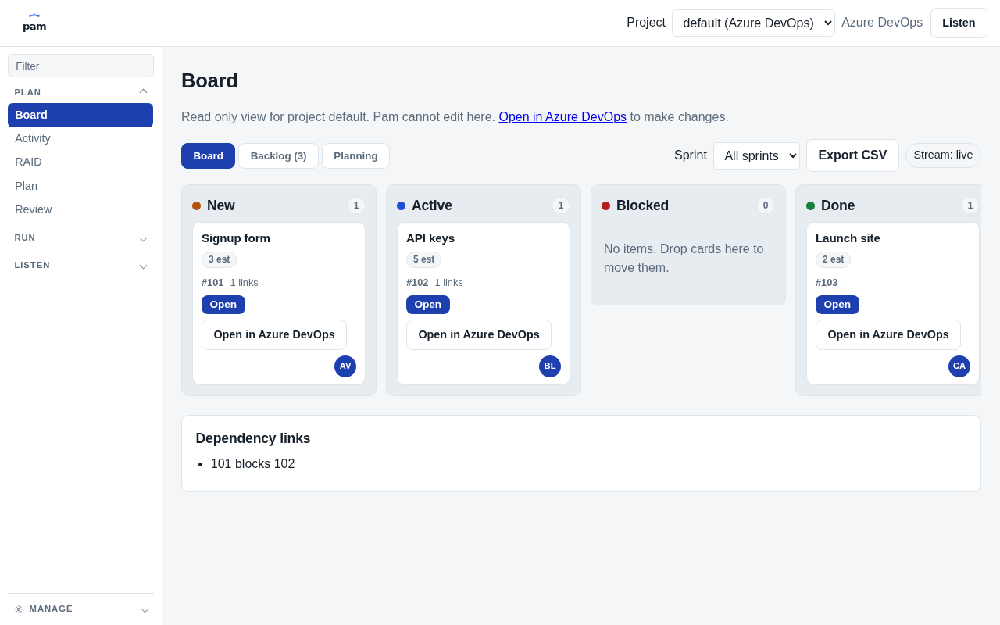

# Pam: Projects Autonomously Managed

Pam is an async project manager that replaces status meetings. It checks in with each teammate in Slack, challenges vague answers, keeps the Azure DevOps board accurate, and chases blockers until they clear.

## Demo

Watch the live run (2:30, recorded on real Slack, real Azure DevOps, and the real console): YouTube link will be posted here with the M6 release.



Screenshots for each console screen live in `docs/images/`.

## Quickstart

You need Python 3.12 or newer, a Meta Model API key, a Slack workspace where you can create an app, and an Azure DevOps project with a PAT.

Install with pipx (recommended, no PyPI release yet):

```sh
pipx install git+https://github.com/OWNER/pam-pm.git
pam start
```

If the `pam` name is taken on your machine, use the `pam-pm` alias instead:

```sh
pam-pm start
```

`pam start` prints a one-time setup token and opens the setup wizard at `http://127.0.0.1:8765/setup?token=...`. Work through each step until every Test button is green, then the console lands on the live Board. See [docs/setup.md](docs/setup.md) for the full walkthrough.

Or run with Docker:

```sh
cp .env.example .env
docker compose up
```

Then open the URL printed in the logs and complete the same setup wizard. The console binds to 127.0.0.1 only.

Check your environment at any time with:

```sh
pam doctor
```

## What it does

- Morning check-ins in Slack DM: one question at a time, with pushback on vague answers until remaining work and an ETA are stated.
- Board sync with Azure DevOps: status updates, comments, and dependency links written with a quoted evidence line behind each write.
- Blocker intake: asks what is blocked, finds or creates the blocking item, links it, asks the owner for an ETA, and notifies the waiting person when it clears.
- Sprint review and retro: synthesizes per-item status into a review and creates retro actions in ADO tagged `retro-action`.
- Sticky-note photo to sprint: segments a planning photo, reads each note, proposes a sprint, and creates the items after you press Approve.

## Rules summary

A rule is a trigger plus an action, toggled per project on the Rules screen. Three templates ship built in:

1. Morning check-in (schedule trigger): DMs each person with active items at the set time. Skips people with nothing active.
2. Follow-up on close (ADO change trigger): when an item closes, DMs the next owner in the chain and asks for status.
3. Blocker intake (Slack message trigger): runs the blocker loop described below.

Details: [docs/rules.md](docs/rules.md).

## How it works

One process holds the FastAPI console, the Slack Socket Mode listener, the APScheduler scheduler, the ADO poller (WIQL on ChangedDate with a stored watermark), and the agent runtime. State lives in SQLite in the OS user data directory. All model calls go through one `build_messages()` with a stable cached prefix; volatile data goes last. Slack DMs and board writes flow through the same event bus that feeds the Activity screen.

The blocker loop, end to end:

1. Report: a teammate says they are blocked in a Slack DM.
2. Intake: Pam asks two or three questions (what is blocked, who or what blocks it, impact) and confirms the blocking item.
3. Link: Pam finds or creates the blocking item in ADO and creates a Predecessor/Successor dependency link.
4. ETA: Pam DMs the blocking owner for an ETA, after telling the reporter first.
5. Watch: the ADO poller notices when the blocking item closes (Closed on Agile, Done on Scrum).
6. Notify: Pam tells the waiting person the blocker cleared and asks for status.

## Built with Meta (hackathon)

Pam was built for the Meta Global AI Developer Hackathon. Recorded usage from DEVLOG.md:

- Muse Spark 1.3 via the Meta Model API: the interviewer agent uses tool calling (`finish_interview`) with structured results, pushback over up to 6 turns, and review/retro synthesis at 6000 tokens or more. The M0 probe confirmed tool choice `auto` works, image input works, and a cold start returned 113 cached of 539 input tokens.
- SAM 3.1 plus vision fallback: the M0 probe listed models and confirmed `sam-3.1` is present. Planning photos use SAM masks with a fallback to a full image read by Muse Spark when no masks come back.
- Muse Code harness: DEVLOG logs every build task executed by Muse Code, from the T0 skeleton through the M3 console, review, and plan screens (55 tests passing at M3). The orchestrator role (Hermes, profile `pam-builder`) plans milestones and reviews diffs per `docs/design/HANDOFF.md`; DEVLOG records the Muse Code executions and measured spend, about $0.16 total at M3 against the $100 cap.

## Privacy and safety

- Private by default: raw answers stay between the person and the agent. The lead sees synthesized status, evidence quotes, and board writes, never full transcripts.
- Masking: emails, phones, and tokens are masked before any model call, and masking is unit tested.
- Standard tier default: Contributor tier may train on inputs and outputs, so it is used only for development with fake data.
- Dry-run default: board writes are proposed first; every write is logged with its evidence quote.
- Undo: reversible writes can be undone from the Activity screen.

Details: [docs/privacy.md](docs/privacy.md).

## Slack app note

Each user creates their own internal Slack app in their own workspace from the manifest at the repo root (`slack-app-manifest.yaml`), using Socket Mode. There is no shared or distributed bot. Pam keeps its own conversation store and never reads Slack history. Setup steps: [docs/slack-setup.md](docs/slack-setup.md).

## Roadmap

Near term: PyPI release, daily lead digest, per-person snooze and quiet hours, Teams stub, MCP connectors for Jira, Linear, and Asana (design notes only today). Longer term: packaged desktop app and hosted version. Full list: [docs/roadmap.md](docs/roadmap.md).

## Contributing, license, and status

Contributions are welcome; see [CONTRIBUTING.md](CONTRIBUTING.md). Security reports: [SECURITY.md](SECURITY.md). License: MIT, see [LICENSE](LICENSE).

Status: alpha. The API, console screens, and rule templates may change without notice. v0.1.0 is unreleased; see [CHANGELOG.md](CHANGELOG.md).
